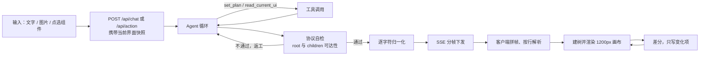

# A2UI · 生成式 UI 应用

用一句话、一张参考图，或直接点选页面上的某个组件，让模型生成并修改可交互界面。

---

## 这是什么

面向产品与前端人员的临时界面需求：静态线框图无法验证交互，手写代码又成本太高。本应用让模型输出界面协议，前端解析为组件树并渲染，支持点选单个组件做增量修改，也支持点击按钮触发下一轮生成。

采用协议驱动的渲染架构：渲染器不认识任何具体页面，只按协议中的组件类型与 `children` 指针建树。生成侧是一个带工具的 Agent：复杂需求先规划，改动前读取画布快照，输出前自检协议可达性，不通过则自动返工。

## 演示

### 生成页面（22s）

[▶ 观看录屏](docs/images/demo-page.mp4)

### 表单（21s）

[▶ 观看录屏](docs/images/demo-form.mp4)

### 计数器交互（23s）

[▶ 观看录屏](docs/images/demo-counter.mp4)

## 快速开始

```bash
pnpm install

# 在 server/a2ui-server 下创建 .env 并填写
#   OPENAI_API_KEY=sk-xxx
#   OPENAI_BASE_URL=https://dashscope.aliyuncs.com/compatible-mode/v1
#   OPENAI_MODEL=qwen3.8-max              # 需支持 Function Calling 与图像输入
#   OPENAI_ENABLE_THINKING=false          # 可选，关闭思考模式（默认开启）

pnpm --filter @a2ui/server dev         # http://127.0.0.1:3000
pnpm --filter @a2ui/playground dev     # http://127.0.0.1:5173
```

服务端启动后访问 `http://127.0.0.1:3000/api/health`，返回 `hasRealAgent: true` 即表示 Key 已生效。

## 技术要点

**一、协议解析与渲染**
解析 A2UI 的 5 类消息与 8 类组件，按 `children` 指针递归建树，并求值数据绑定与语义化样式提示。渲染器不含任何具体页面逻辑，扩展组件只需补充协议类型与渲染映射。预览区固定按 1200px 桌面宽度渲染，再按面板宽度等比缩放，保证布局与真实宽屏一致。

**二、Agent 工具循环**
模型通过 Function Calling 使用三个工具：`set_plan` 为复杂需求先列计划，`read_current_ui` 在修改前读取画布快照，`validate_protocol` 在输出前自检消息完整性与组件可达性。自检不通过会把错误回喂模型返工，最多 2 轮。

**三、流式管道**
思考过程与工具轨迹（`reasoning` / `thought` / `plan` / `tool_call` / `tool_result`）作为独立 SSE 事件实时下发；协议文本先经服务端逐字符归一化——剥离代码围栏与叙述性文字、剔出对象内的空白、在对象之间补换行；再按 SSE 分帧下发。客户端按空行拆分事件帧、处理跨块的半帧，最后按行解析，坏行仅丢弃、不影响同轮其余消息。

**四、增量更新与事件回传**
点选组件后携带当前界面快照请求修改，服务端要求模型必须返回完整协议；客户端对新旧组件集合做差集，只写入变化项，未变节点因 key 稳定而免于重建。组件事件（按钮点击）转为文本指令，复用同一生成链路触发下一轮生成。

## 协议说明

一条消息一行 JSON，扁平组件表 + `children` 指针：

```jsonl
{"type":"createSurface","surfaceId":"s1"}
{"type":"surfaceUpdate","surfaceId":"s1","components":[{"id":"root","componentType":"Column","props":{"gap":8},"children":["t1"]}]}
{"type":"surfaceUpdate","surfaceId":"s1","components":[{"id":"t1","componentType":"Text","props":{"text":"登录"}}]}
{"type":"beginRendering","surfaceId":"s1","root":"root"}
```

消息类型 5 类：`createSurface` / `surfaceUpdate` / `dataModelUpdate` / `beginRendering` / `deleteSurface`
组件类型 8 类：`Text` / `Button` / `Image` / `Input` / `Column` / `Row` / `Card` / `List`

两点设计约束：

- 渲染须待 `beginRendering` 到达、根节点确定后方可开始，故渲染为整包一次性完成，非逐帧上屏；
- `Input` 必须带 `dataBinding`，否则用户输入无法回写数据模型。

## 架构



```
packages/a2ui-core/       协议类型 / 行解析 / 流式缓冲 / 状态中枢 / 建树
packages/a2ui-react/      React 渲染层：8 类组件的渲染函数 + 样式提示查表
server/a2ui-server/       Koa 服务端：Agent 循环、工具调用、协议自检、归一化、SSE、会话
web/playground/           调试台：对话区、1200px 预览画布、点选、图片压缩
```

## 技术栈

React 18 · TypeScript · pnpm workspace · Vite · Node.js + Koa · SSE · OpenAI 兼容接口（Function Calling / 多模态 / 思考模式）· canvas 图片压缩