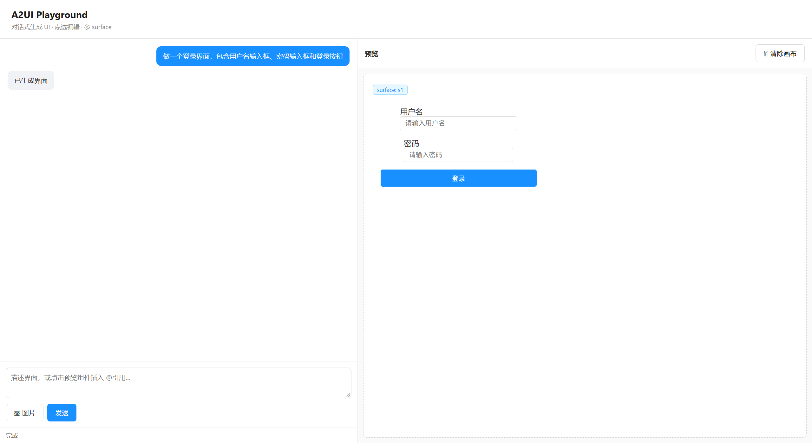
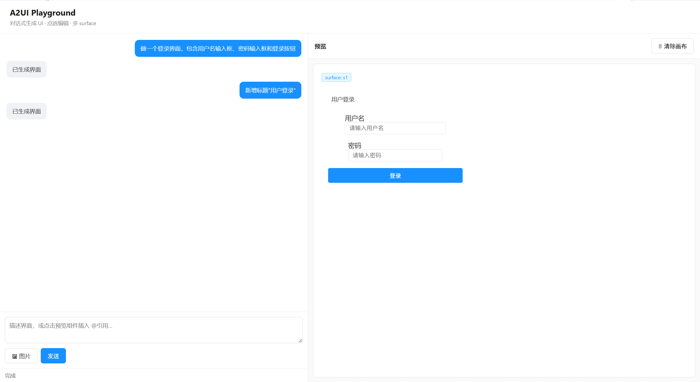
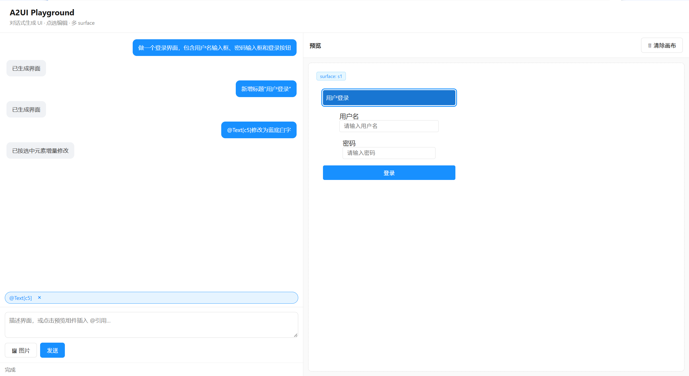
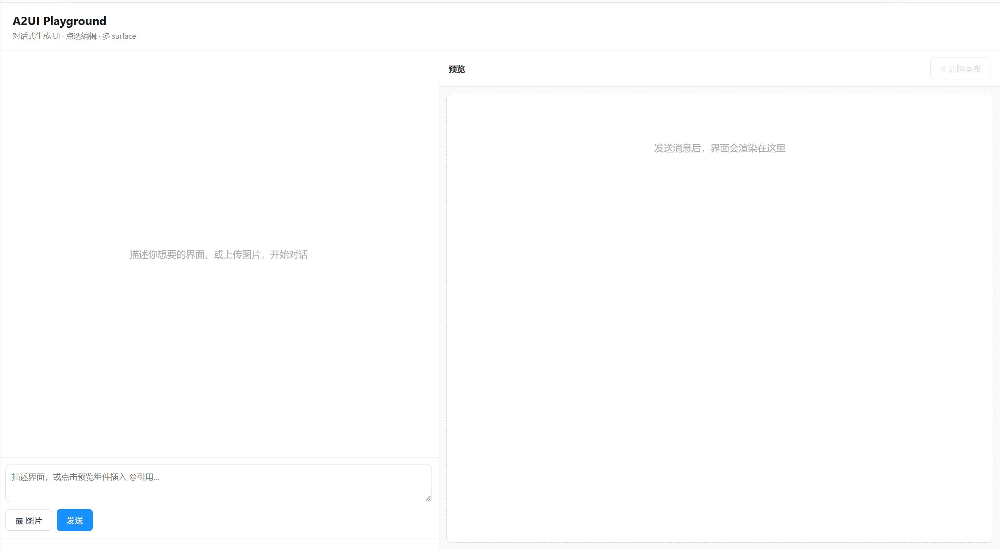
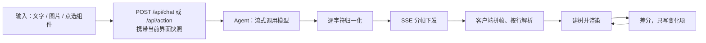

# A2UI · 生成式 UI 应用



用一句话、一张参考图，或直接点选页面上的某个组件，让模型生成并修改可交互界面。

---

## 这是什么

面向产品与前端人员的临时界面需求：静态线框图无法验证交互，手写代码又成本太高。本应用让模型输出界面协议，前端解析为组件树并渲染，支持点选单个组件做增量修改，也支持点击按钮触发下一轮生成。

采用协议驱动的渲染架构：渲染器不认识任何具体页面，只按协议中的组件类型与 `children` 指针建树。

## 演示

| 生成登录界面 | 新增组件 |
|---|---|
|  |  |

| 修改选中组件 | 计数器交互 |
|---|---|
|  |  |

- **生成登录界面**：一句描述，直接产出可交互的登录表单。
- **新增组件**：在既有界面上追加组件，父容器的 `children` 同步挂接。
- **修改选中组件**：点选目标组件后仅改动该节点，其余节点不重建。
- **计数器交互**：点击按钮触发组件事件回传，进入下一轮生成。

## 快速开始

```bash
pnpm install

# 配置模型：复制 server/a2ui-server/.env.example 为 .env 后填写
#   OPENAI_API_KEY=sk-xxx
#   OPENAI_BASE_URL=https://api.deepseek.com/v1
#   OPENAI_MODEL=deepseek-chat           # 纯文本
#   OPENAI_VL_MODEL=qwen-vl-plus         # 含图片请求时自动切换

pnpm --filter @a2ui/server dev        # http://127.0.0.1:3000
pnpm --filter @a2ui/playground dev    # http://127.0.0.1:5173
```

服务端启动后访问 `http://127.0.0.1:3000/api/health`，返回 `hasRealAgent: true` 即表示 Key 已生效。

> 本项目不提供 Mock 模式，需自备 OpenAI 兼容接口的 Key。

## 技术要点

**一、协议解析与渲染**
解析 A2UI 的 5 类消息与 8 类组件，按 `children` 指针递归建树，并求值数据绑定与语义化样式提示。渲染器不含任何具体页面逻辑，扩展组件只需补充协议类型与渲染映射。

**二、流式管道**
模型输出先经服务端逐字符归一化——剥离代码围栏与叙述性文字、剔出对象内的空白、在对象之间补换行；再按 SSE 分帧下发。客户端按空行拆分事件帧、处理跨块的半帧，最后按行解析，坏行仅丢弃、不影响同轮其余消息。

**三、增量更新与事件回传**
点选组件后携带当前界面快照请求修改，服务端校验模型必须返回完整协议，仅返回补丁的响应整轮丢弃；客户端对新旧组件集合做差集，只写入变化项，未变节点因 key 稳定而免于重建。组件事件（按钮点击）复用同一生成链路，触发下一轮整页生成。

## 协议说明

一条消息一行 JSON，扁平组件表 + `children` 指针：

```jsonl
{"type":"createSurface","surfaceId":"s1"}
{"type":"surfaceUpdate","surfaceId":"s1","components":[{"id":"root","componentType":"Column","props":{"gap":8},"children":["t1"]}]}
{"type":"surfaceUpdate","surfaceId":"s1","components":[{"id":"t1","componentType":"Text","props":{"text":"登录"}}]}
{"type":"beginRendering","surfaceId":"s1","root":"root"}
```

消息类型 5 类：`createSurface` / `surfaceUpdate` / `dataModelUpdate` / `beginRendering` / `deleteSurface`
组件类型 8 类：`Text` / `Button` / `Image` / `Input` / `Column` / `Row` / `Card` / `List`

两点设计约束：

- 渲染须待 `beginRendering` 到达、根节点确定后方可开始，故渲染为整包一次性完成，非逐帧上屏；
- `Input` 必须带 `dataBinding`，否则用户输入无法回写数据模型。

## 架构



```
packages/a2ui-core/       协议类型 / 行解析 / 流式缓冲 / 状态中枢 / 建树
packages/a2ui-react/      React 渲染层：8 类组件的渲染函数 + 样式提示查表
server/a2ui-server/       Koa 服务端：Agent 调用、归一化、SSE、会话
web/playground/           调试台：对话区、预览画布、点选、图片压缩
```

## 已知边界

- 无持久化：会话存于进程内存，刷新即失，界面不落库
- 表单可生成可输入字段，但无提交接口与校验，输入仅回写本地数据模型
- 渲染为整包一次完成，不做逐帧上屏（受 `beginRendering` 时机限制）
- 事件回传路径目前复用同一生成链路，未单独做完整协议校验

## 技术栈

React 18 · TypeScript · pnpm workspace · Vite · Node.js + Koa · SSE · OpenAI 兼容接口（文本与多模态）· canvas 图片压缩